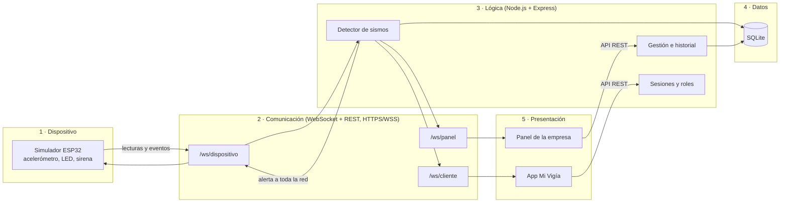

# Vigía · Sistema de alerta sísmica temprana


Proyecto de la materia **Construcción de Software** · versión **1.0.0**.

Vigía es un dispositivo para el hogar que detecta sismos con un acelerómetro, hace sonar una alarma y avisa a una plataforma central que alerta a toda la red. Como todavía no tenemos el hardware, este repositorio contiene el **sistema completo en software**:

| Parte | Carpeta | Para quién | Qué hace |
|---|---|---|---|
| Simulador de dispositivos | `simulador/` | — | Imita el firmware del ESP32 en 12 casas de Colombia: lee el acelerómetro, detecta, hace sonar la alarma y funciona aunque no haya conexión. |
| Plataforma central | `servidor/` | — | Recibe los datos por WebSocket, confirma si hay un sismo real, guarda todo en SQLite y avisa a toda la red. |
| Panel de la empresa | `dashboard/` | Admin y operadores | Monitoreo en vivo, historial con filtros, dispositivos y clientes, solicitudes de ayuda y simulación de sismos. |
| App del cliente «Mi Vigía» | `dashboard/cliente/` | Cada hogar | Estado de su dispositivo, alerta de sismo con «Estoy bien», historial, sensibilidad y contactos de emergencia. |
| Pruebas | `tests/` | — | 44 pruebas automáticas que se ejecutan en GitHub con cada cambio. |

La relación entre cada requerimiento del documento del proyecto, el código que lo cumple y la prueba que lo verifica está en **[docs/trazabilidad.md](docs/trazabilidad.md)**.

## Arquitectura

Arquitectura por capas, la misma del documento del proyecto:



## Requisitos

- [Node.js](https://nodejs.org/) **22.13 o superior** (se recomienda la versión LTS). Incluye SQLite, así que no hay que instalar ninguna base de datos.
- [Git](https://git-scm.com/).

## Cómo correrlo

```bash
git clone https://github.com/AndresMurillo24/Vigia-sistema.git
cd Vigia-sistema
npm install
npm start
```

La primera vez, la terminal muestra la contraseña del usuario **admin** (se genera al azar). Guárdala.

- **Panel de la empresa:** http://localhost:3000 → inicia sesión con `admin`.
- **App del cliente:** http://localhost:3000/cliente → crea una cuenta y vincula un dispositivo con su código (ver más abajo). En el celular se instala como app desde el menú del navegador («Agregar a la pantalla de inicio»).

Todo queda guardado en la carpeta `datos/` (base de datos SQLite): al volver a ejecutar `npm start` siguen las cuentas, los dispositivos vinculados y el historial.

| Comando | Para qué |
|---|---|
| `npm start` | Levanta la plataforma y los 12 dispositivos simulados. |
| `npm run start:https` | Lo mismo, pero **cifrado con HTTPS y WSS** en https://localhost:3443 (ver *Seguridad*). |
| `npm run servidor` | Solo la plataforma central. |
| `npm run simulador` | Solo los dispositivos, en otra terminal. Acepta el comando `sismo` (ver *Disponibilidad*). |
| `npm test` | Ejecuta las 44 pruebas automáticas. |
| `npm run usuario -- <usuario> <admin\|operador> "<Nombre>"` | Crea un usuario del panel o cambia su contraseña. |

Para usar otro puerto: `PUERTO=4000 npm start` (en PowerShell: `$env:PUERTO=4000; npm start`).
Para fijar la contraseña inicial del admin: `ADMIN_CLAVE=tu-clave npm start` (solo cuando la base de datos está vacía).

## Panel de la empresa

| Sección | Qué permite | Requerimiento |
|---|---|---|
| **Monitoreo** | Mapa de Colombia con los 12 dispositivos, gráfica en vivo del que se elija, alertas, eventos y simulación de sismos (solo admin). | RF05, RF07 |
| **Historial** | Buscar eventos o alertas por fechas, ciudad y aceleración mínima, con paginación y **exportación a CSV** (Excel). | RF04 |
| **Dispositivos y clientes** | Cada dispositivo con su dueño, conexión, batería, WiFi y sensibilidad; la lista de clientes. El admin puede **desvincular** un dispositivo (por ejemplo, si se vende la casa). | RF06 |
| **Solicitudes de ayuda** | Los hogares que marcaron «Necesito ayuda», con su dirección y los teléfonos de sus contactos, para llamarlos y marcarlos como **atendidos**. | RF05 |

| Rol | Puede |
|---|---|
| `admin` | Todo: ver, simular sismos y desvincular dispositivos. |
| `operador` | Ver el panel, consultar el historial y atender solicitudes de ayuda. |

Ejemplo para crear un operador: `npm run usuario -- daniel operador "Daniel Márquez"` (pide la contraseña).

## App del cliente «Mi Vigía»

Cada familia que compra Vigía usa esta app desde el celular. Tiene letra grande, botones amplios y alto contraste para que la usen también adultos mayores.

| Función | Requerimiento |
|---|---|
| Crear cuenta e iniciar sesión | RNF Seguridad |
| **Vincular** el dispositivo con el código de la caja (`VG-XXXX-XXXX`) | RF06 |
| Ver en vivo su dispositivo: conexión, batería, WiFi, sensibilidad y vibración de los últimos 30 s | RF05 |
| **Alerta a pantalla completa** con sonido y vibración cuando hay un sismo, con la distancia a su casa | RF05 |
| Responder **«Estoy bien»** o **«Necesito ayuda»**; la respuesta llega al panel de la empresa | RF05 |
| **Historial** de alertas y de lo que detectaron sus dispositivos | RF04 |
| Cambiar **nombre, dirección y sensibilidad** (0,05 a 0,40 g); el nuevo umbral le llega al dispositivo | RF01, RF06 |
| **Probar la alarma** desde el celular | RF02 |
| Hasta 5 **contactos de emergencia** | RF06 |

Códigos de algunos dispositivos simulados (los demás están en `simulador/dispositivos.json`):

| Dispositivo | Código |
|---|---|
| Casa Chapinero (Bogotá) | `VG-RRPR-A5S9` |
| Casa Suba (Bogotá) | `VG-KVA7-RFR5` |
| Casa Kennedy (Bogotá) | `VG-GZUL-M2R4` |

> El envío de mensajes de texto a los contactos de emergencia requiere un proveedor de SMS y no está incluido: cuando un hogar pide ayuda, el panel muestra los teléfonos de sus contactos para que el operador los llame.

## Cómo funciona la detección

1. **Cada dispositivo** compara su lectura con su umbral (por defecto **0,15 g**). Si lo supera, enciende su alarma de inmediato, sin esperar a la plataforma, y envía un *evento*.
2. **La plataforma** no declara un sismo con un solo dispositivo (podría ser un portazo o un camión). Espera a que **al menos 2 dispositivos** a menos de **300 km** coincidan en **10 segundos**.
3. Cuando se confirma, guarda la alerta y **la envía a todos los dispositivos y a todas las apps**. Las casas lejanas reciben el aviso antes de que les llegue la onda S, la que más sacude: esa es la *alerta temprana*.

Los valores se cambian en `servidor/config.js`. El modelo de propagación de `simulador/modelo.js` es simplificado y acelera los tiempos ×3 para la demostración; no es un modelo sismológico real.

## Disponibilidad: funciona sin conexión

El sensor y la alarma del dispositivo no dependen de la plataforma. Si se cae internet, el dispositivo **sigue detectando y sonando**, guarda los eventos y los envía con su hora real cuando vuelve la conexión. Esos eventos quedan en el historial, pero no disparan alertas viejas.

Para verlo:

1. En una terminal: `npm run servidor`. En otra: `npm run simulador`.
2. Detén el servidor con `Ctrl + C`.
3. En la terminal del simulador escribe `sismo`: los dispositivos cercanos hacen sonar su alarma y muestran `[SIN CONEXIÓN] … evento guardado`.
4. Vuelve a iniciar el servidor: los dispositivos se reconectan solos y envían lo guardado (`[RECONEXIÓN]`), que aparece en el *Historial* del panel.

## Seguridad implementada

**Cifrado (HTTPS/WSS).** Con `npm run start:https` la plataforma funciona en https://localhost:3443 y los dispositivos se conectan por `wss://`. Para pruebas genera un certificado autofirmado en `datos/` (el navegador muestra una advertencia la primera vez: se acepta). En un despliegue real se usa un certificado válido con las variables `TLS_CERT` y `TLS_KEY`. Con HTTPS la cookie de sesión solo viaja cifrada (`Secure`) y se envía la cabecera HSTS.

**Autenticación y sesiones.**
- Contraseñas con **scrypt** y sal aleatoria; sesiones guardadas en el servidor con cookie `HttpOnly` y `SameSite=Strict`.
- Bloqueo de 15 minutos tras 5 intentos fallidos; el mismo mensaje de error para usuario inexistente y contraseña incorrecta.
- Roles `admin` y `operador`; las cuentas de clientes están separadas de las del panel (cookie y sesiones propias).
- Cada dispositivo se autentica con un **token**; la base de datos solo guarda su **hash SHA-256** y la comparación es en tiempo constante.

**Control de acceso.**
- La API, el canal en vivo del panel y el de la app exigen sesión; simular y desvincular exigen rol `admin`.
- **Cada cliente solo ve y modifica sus propios dispositivos y contactos** (protección contra IDOR): un identificador ajeno responde 404.
- El código de vinculación se guarda como hash, un dispositivo vinculado no se puede tomar desde otra cuenta y hay un límite de 10 códigos incorrectos por hora.

**Datos de entrada y salida.**
- **Validación con lista blanca** de todos los mensajes y formularios: tipos permitidos, números finitos, rangos físicos posibles (±16 g) y mensajes de máximo 1 KB.
- **Consultas SQL con parámetros** (también en los filtros del historial) para evitar inyección SQL.
- El panel y la app **escapan todo texto** antes de mostrarlo, para evitar XSS, y la política **Content-Security-Policy** solo permite scripts de la propia plataforma.
- La exportación CSV neutraliza fórmulas de Excel (inyección CSV).
- La sensibilidad solo acepta valores seguros (0,05–0,40 g).

**Proceso.** GitHub Actions ejecuta las pruebas y `npm audit` en cada cambio (ver la insignia al inicio).

> Los tokens y códigos de `simulador/dispositivos.json` son solo para la simulación. En un sistema real se entregan a cada dispositivo al fabricarlo y nunca se guardan en el repositorio.

## Pruebas

`npm test` ejecuta 44 pruebas con el módulo `node:test`. GitHub las ejecuta automáticamente en Node.js 22 y 24 con cada `push` y cada Pull Request (`.github/workflows/pruebas.yml`).

| Archivo | Qué prueba |
|---|---|
| `detector.test.js` | Un solo dispositivo no alerta; dos cercanos sí; los lejanos o fuera de tiempo no se suman. |
| `integracion.test.js` | Flujo completo: dispositivos → plataforma → panel y alerta a la red. |
| `auth.test.js` | Contraseñas, cookies, roles, bloqueo por intentos y cierre de sesión. |
| `cliente.test.js` | App del cliente: registro, vinculación, IDOR, sensibilidad, prueba de alarma, contactos y alertas. |
| `gestion.test.js` | Historial con filtros, CSV, red, desvinculación, solicitudes de ayuda y eventos diferidos. |
| `disponibilidad.test.js` | El dispositivo detecta y suena sin conexión y envía lo guardado al reconectarse. |
| `https.test.js` | La plataforma funciona cifrada por HTTPS y WSS y envía las cabeceras de seguridad. |
| `validacion.test.js`, `seguridad.test.js`, `geo.test.js` | Validación de datos, hash de tokens y cálculo de distancias. |

## Estructura

```
├── inicio.js                  # npm start: servidor + simulador
├── compartido/geo.js          # distancia entre coordenadas
├── servidor/
│   ├── index.js               # arranque (HTTP o HTTPS)
│   ├── app.js                 # API, WebSockets y flujo principal
│   ├── detector.js            # confirma sismos con varios dispositivos
│   ├── portal-cliente.js      # API y canal en vivo de la app del cliente
│   ├── gestion.js             # historial, CSV, red y solicitudes de ayuda
│   ├── auth.js                # inicio de sesión, sesiones y roles
│   ├── seguridad.js           # hash de tokens y contraseñas
│   ├── validacion.js          # validación de todo lo que entra
│   ├── certificado.js         # certificado TLS para HTTPS
│   ├── db.js                  # base de datos SQLite
│   ├── semilla.js             # registra los dispositivos simulados
│   └── config.js              # umbrales y parámetros
├── simulador/
│   ├── index.js               # crea los dispositivos (y la consola «sismo»)
│   ├── dispositivo.js         # firmware simulado del ESP32
│   ├── modelo.js              # propagación simplificada de las ondas
│   └── dispositivos.json      # las 12 casas simuladas
├── dashboard/                 # panel de la empresa
│   ├── login.html, index.html, estilos.css
│   ├── app.js                 # monitoreo en vivo
│   ├── gestion.js             # historial, red y solicitudes de ayuda
│   └── cliente/               # app del cliente «Mi Vigía»
├── scripts/usuario.js         # crear usuarios del panel
├── tests/                     # 44 pruebas con node:test
├── docs/trazabilidad.md       # requerimiento → código → prueba
└── .github/workflows/         # pruebas automáticas en GitHub
```

Cada archivo de código empieza con un encabezado que indica su nombre, tipo, capa y función.

## Cómo trabajamos con Git

1. Antes de empezar: `git pull` para tener lo último de `main`.
2. Crea una rama para tu cambio: `git checkout -b nombre-del-cambio`.
3. Haz commits pequeños con mensajes claros.
4. Sube la rama (`git push -u origin nombre-del-cambio`) y abre un **Pull Request**.
5. GitHub ejecuta las pruebas; otro integrante revisa y lo une a `main`. La rama `main` siempre debe funcionar.

## Versiones

| Versión | Contenido |
|---|---|
| 0.1 | Base del sistema: simulador, plataforma central con detector y panel de monitoreo. |
| 0.2 | Inicio de sesión del panel con roles `admin` y `operador`. |
| 0.3 | App del cliente «Mi Vigía». |
| **1.0** | Historial con filtros y CSV, gestión de dispositivos y clientes, solicitudes de ayuda, funcionamiento sin conexión, HTTPS/WSS, pruebas automáticas en GitHub y documentación de trazabilidad. |

## Equipo

- Daniel Andrés Márquez · 20222020238
- Andrés David Murillo · 20222020230
- Andrés Julián Vargas · 20221020069

Docente: Leonardo Molina.
