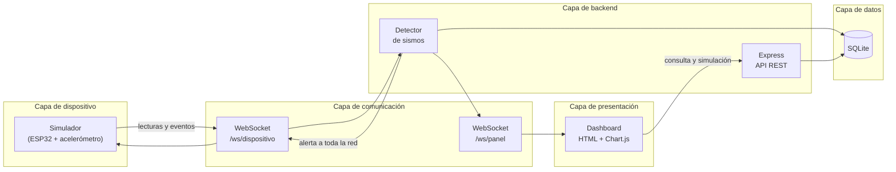

# Vigía · Sistema de alerta sísmica temprana

Proyecto de la materia **Construcción de Software**.
Vigía es un dispositivo para el hogar que detecta sismos con un acelerómetro y avisa a una plataforma central. Como todavía no tenemos el hardware, este repositorio contiene el **sistema completo en software**:

| Parte | Carpeta | Qué hace |
|---|---|---|
| Simulador de dispositivos | `simulador/` | Imita el firmware del ESP32 en 12 casas de Colombia: lee el acelerómetro 10 veces por segundo, detecta vibraciones y activa la alarma. |
| Plataforma central | `servidor/` | Recibe las lecturas por WebSocket, confirma si hay un sismo real, guarda todo en SQLite y avisa a toda la red. |
| Panel de monitoreo | `dashboard/` | Página web con el mapa de dispositivos, la gráfica en vivo, las alertas y un botón para simular sismos. |
| Pruebas | `tests/` | Pruebas automáticas de la lógica, la validación, la seguridad y el flujo completo. |

## Arquitectura



## Requisitos

- [Node.js](https://nodejs.org/) **22.13 o superior** (se recomienda la versión LTS). Incluye SQLite, así que no hay que instalar ninguna base de datos.
- [Git](https://git-scm.com/).
- Un editor, por ejemplo [VS Code](https://code.visualstudio.com/).

## Cómo correrlo

```bash
git clone https://github.com/AndresMurillo24/Vigia-sistema.git
cd Vigia-sistema
npm install
npm start
```

La primera vez, la terminal muestra la contraseña del usuario **admin** (se genera al azar). Guárdala.
Abre **http://localhost:3000**, inicia sesión y verás los 12 dispositivos en línea. En la tarjeta *Simular un sismo* elige un epicentro y una magnitud y pulsa el botón: en la terminal y en el panel se ve todo el proceso.

| Comando | Para qué |
|---|---|
| `npm start` | Levanta la plataforma y los dispositivos simulados a la vez. |
| `npm run servidor` | Solo la plataforma central. |
| `npm run simulador` | Solo los dispositivos (en otra terminal, con el servidor ya corriendo). |
| `npm test` | Ejecuta las pruebas automáticas. |
| `npm run usuario -- <usuario> <admin\|operador> "<Nombre>"` | Crea un usuario del panel o cambia su contraseña. |

Para usar otro puerto: `PUERTO=4000 npm start` (en PowerShell: `$env:PUERTO=4000; npm start`).
Para fijar la contraseña inicial del admin en vez de generarla: `ADMIN_CLAVE=tu-clave npm start` (solo aplica cuando la base de datos está vacía).

## Usuarios del panel

| Rol | Puede |
|---|---|
| `admin` | Ver el panel y simular sismos. |
| `operador` | Ver el panel en vivo, sin poder simular. |

Ejemplo para crear un operador: `npm run usuario -- daniel operador "Daniel Márquez"` (pide la contraseña).
Si olvidas la del admin: `npm run usuario -- admin admin "Administrador"`.

## Cómo funciona la detección

1. **Cada dispositivo** compara su lectura con el umbral (**0,15 g**). Si lo supera, enciende su alarma de inmediato y envía un *evento* a la plataforma.
2. **La plataforma** no declara un sismo con un solo dispositivo (podría ser un portazo o un camión). Espera a que **al menos 2 dispositivos** a menos de **300 km** coincidan en **10 segundos**.
3. Cuando se confirma, guarda la alerta, la muestra en el panel y **la envía a todos los dispositivos de la red**. Las casas lejanas reciben el aviso antes de que les llegue la onda S, que es la que más sacude: esa es la *alerta temprana*.

Los valores se cambian en `servidor/config.js`. El modelo de propagación de `simulador/modelo.js` es simplificado y acelera los tiempos ×3 para la demostración; no es un modelo sismológico real.

## Seguridad implementada

- **Inicio de sesión del panel**: contraseñas con **scrypt** y sal aleatoria; sesiones guardadas en el servidor con cookie `HttpOnly` y `SameSite=Strict`; bloqueo de 15 minutos tras 5 intentos fallidos; el mismo mensaje de error para usuario inexistente y contraseña incorrecta; roles `admin` y `operador`.
- El canal en vivo del panel (`/ws/panel`) y la API exigen sesión; simular sismos exige rol `admin`.
- Cada dispositivo se autentica con un **token**; la base de datos solo guarda su **hash SHA-256** y la comparación es en tiempo constante.
- **Validación con lista blanca** de todos los mensajes: tipos permitidos, números finitos y rangos físicos posibles (±16 g). Mensajes de máximo 1 KB.
- **Consultas SQL con parámetros** (sin concatenar texto) para evitar inyección SQL.
- El panel inserta datos con `textContent`, nunca con `innerHTML`, para evitar XSS.
- Cabeceras HTTP de seguridad y la opción `MODO_SIMULACION=false` para desactivar la simulación en producción.
- Pendiente para el despliegue: HTTPS/WSS (con `COOKIE_SEGURA=true`) y tokens de dispositivos fuera del repositorio.

> Los tokens de `simulador/dispositivos.json` son solo para la simulación. En un sistema real nunca se guardan en el repositorio.

## Estructura

```
├── inicio.js              # npm start: servidor + simulador
├── compartido/geo.js      # distancia entre coordenadas
├── servidor/
│   ├── app.js             # API, WebSockets y flujo principal
│   ├── detector.js        # confirma sismos con varios dispositivos
│   ├── db.js              # base de datos SQLite
│   ├── validacion.js      # validación de mensajes
│   ├── auth.js            # inicio de sesión, sesiones y roles
│   ├── seguridad.js       # tokens y contraseñas
│   ├── semilla.js         # registra los dispositivos simulados
│   └── config.js          # umbrales y parámetros
├── simulador/
│   ├── dispositivo.js     # firmware simulado del ESP32
│   ├── modelo.js          # propagación simplificada de las ondas
│   └── dispositivos.json  # las 12 casas simuladas
├── scripts/usuario.js     # crear usuarios del panel
├── dashboard/             # panel web (login.html + index.html)
└── tests/                 # pruebas con node:test
```

## Cómo trabajamos con Git

1. Antes de empezar: `git pull` para tener lo último de `main`.
2. Crea una rama para tu cambio: `git checkout -b nombre-del-cambio`.
3. Haz commits pequeños con mensajes claros: `git commit -m "Agrega filtro de eventos por ciudad"`.
4. Sube la rama (`git push -u origin nombre-del-cambio`) y abre un **Pull Request** en GitHub.
5. Otro integrante lo revisa y lo une a `main`. La rama `main` siempre debe funcionar y pasar `npm test`.

## Equipo

- Daniel Andrés Márquez · 20222020238
- Andrés David Murillo · 20222020230
- Andrés Julián Vargas · 20221020069

Docente: Leonardo Molina.
